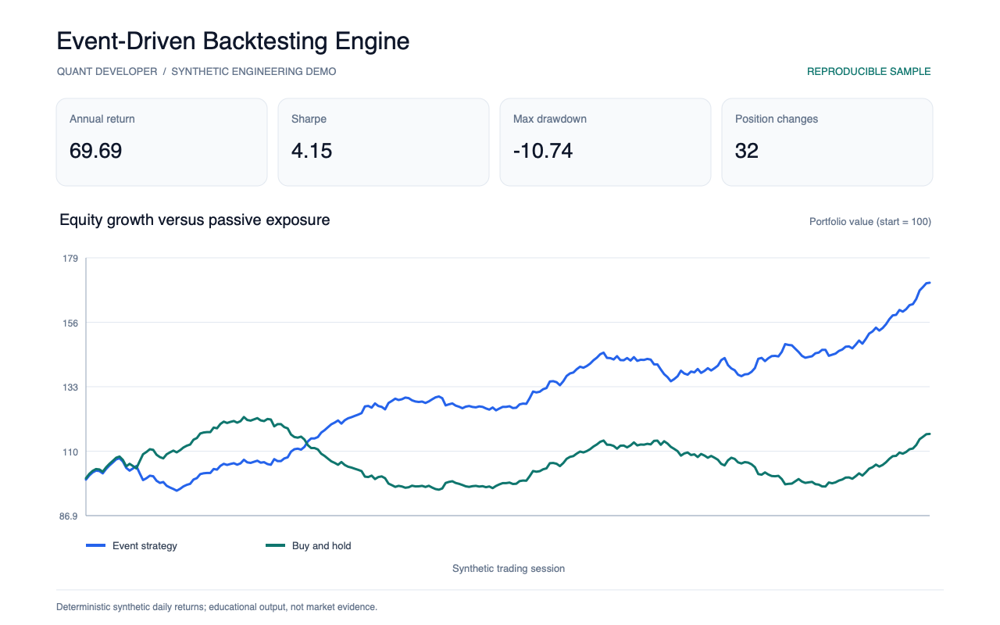
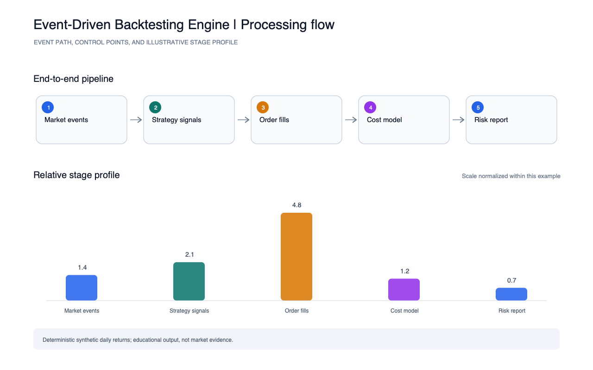

# Event-Driven Backtesting Engine

A deterministic event-driven strategy prototype with position sizing, turnover-based transaction costs, an equity curve, and portfolio-risk summaries.

Run `python3 run.py` to write `reports/metrics.json`. The example reports annualized return and volatility, Sharpe ratio, maximum drawdown, position changes, and turnover.

Run the smoke test with `python3 -m unittest discover -s tests -v`. The report images were generated from these metrics by the portfolio's shared screenshot script.

All returns are generated synthetic observations; this prototype is not a market-data backtest or evidence of strategy performance.
